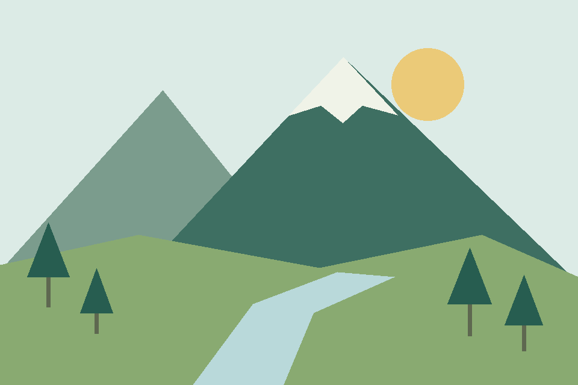
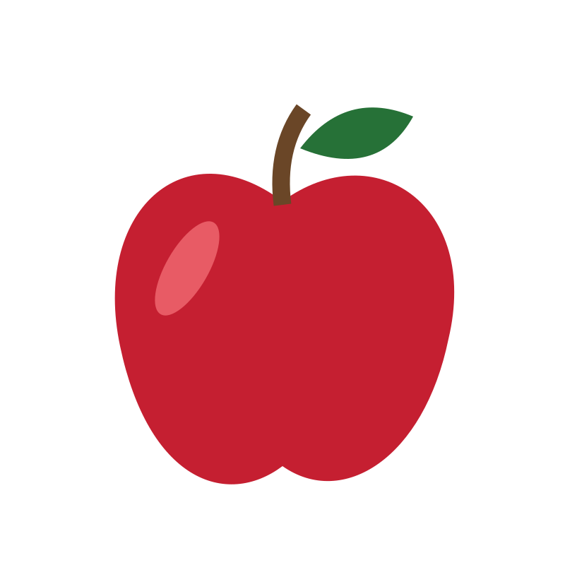
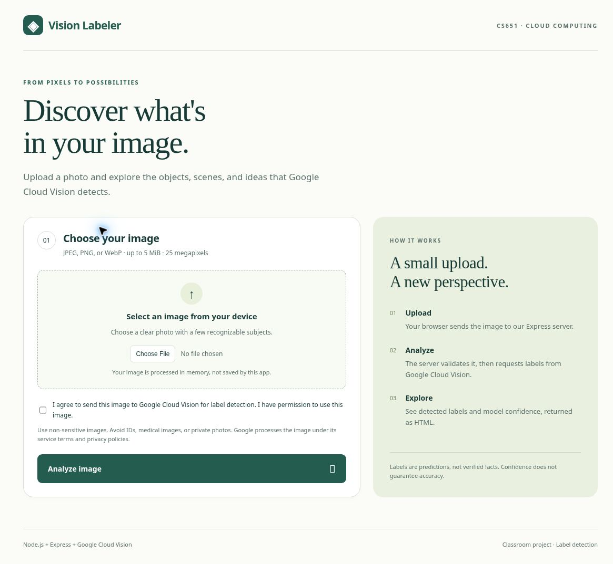
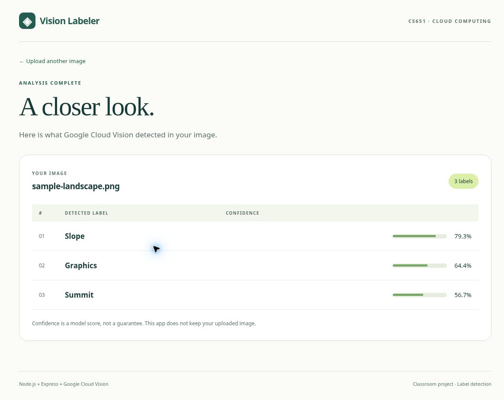
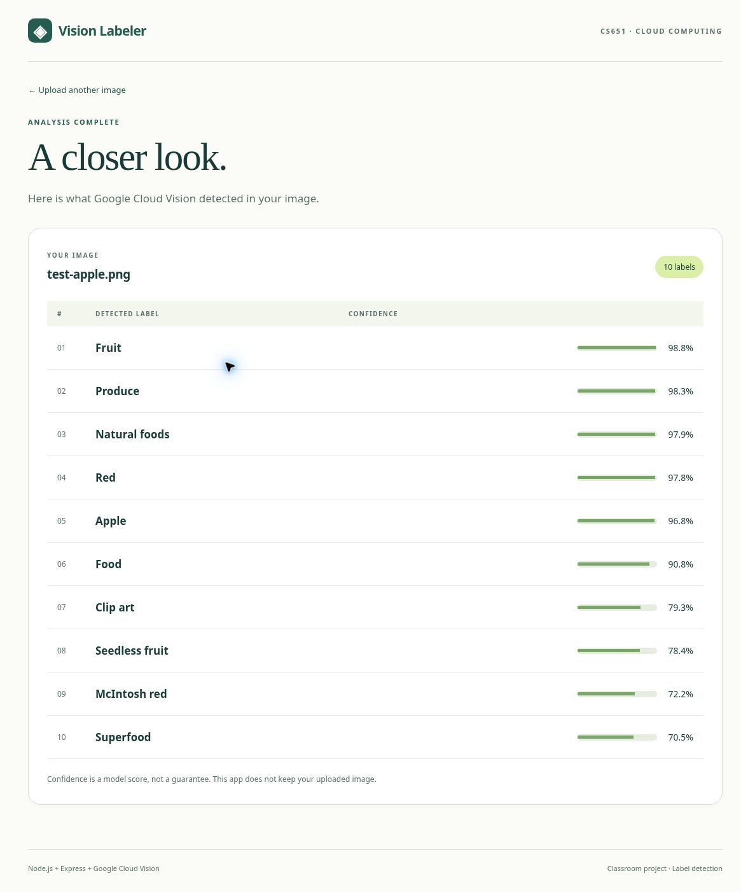

# Demonstration

## Evidence status

Real App Engine and Google Cloud Vision HTTP checks completed on **2026-11-10 at 18:54 UTC**, using deployed version `vision-20261110b`. [Open the live app](https://vision-labeler-dot-cs651-n33-lcho-20261014.uw.r.appspot.com). Two synthetic, non-sensitive images produced distinct real labels. These results were verified through HTTP requests, not the offline fixture detector.

- Landscape: Slope (79.3%), Graphics (64.4%) and Summit (56.7%).
- Apple: Fruit (98.8%), Produce (98.3%), Natural foods (97.9%), Red (97.8%) and Apple (96.8%), among ten labels.
- Missing image or consent returned 400, animated input returned 400, incorrect MIME or corruption returned 415, oversize input returned 413, and cross-origin submission returned 403.
- `/health` returned 200 and reported real Vision mode. This endpoint alone is not evidence that API calls succeed; the two successful image analyses supply that evidence.

## Reproducible source evidence

These links are pinned to the published source commit containing the original deployment evidence:

- [Full deployment record](https://github.com/LinnKhantCho2002/CS651-Vision-Labeler/blob/4dc38a9e03bc92f1ff56a9f2689d675b75bb2218/docs/DEPLOYED.md)
- [Machine-readable live HTTP check log](https://github.com/LinnKhantCho2002/CS651-Vision-Labeler/blob/4dc38a9e03bc92f1ff56a9f2689d675b75bb2218/docs/evidence/live/live-checks.json)
- [Landscape response HTML](https://github.com/LinnKhantCho2002/CS651-Vision-Labeler/blob/4dc38a9e03bc92f1ff56a9f2689d675b75bb2218/docs/evidence/live/sample-landscape-result.html)
- [Apple response HTML](https://github.com/LinnKhantCho2002/CS651-Vision-Labeler/blob/4dc38a9e03bc92f1ff56a9f2689d675b75bb2218/docs/evidence/live/test-apple-result.html)
- [Synthetic landscape input](https://github.com/LinnKhantCho2002/CS651-Vision-Labeler/blob/4dc38a9e03bc92f1ff56a9f2689d675b75bb2218/docs/evidence/sample-landscape.png)
- [Synthetic apple input](https://github.com/LinnKhantCho2002/CS651-Vision-Labeler/blob/4dc38a9e03bc92f1ff56a9f2689d675b75bb2218/docs/evidence/live/test-apple.png)
- [Repeatable HTTP test script](https://github.com/LinnKhantCho2002/CS651-Vision-Labeler/blob/4dc38a9e03bc92f1ff56a9f2689d675b75bb2218/scripts/live-smoke.py), which makes real API requests and consumes quota.

### Test inputs, not screenshots

These are the synthetic input images, not screenshots of the deployed application or proof by themselves of API success.

## Live demonstration script

1. Open the deployed HTTPS address and explain the image-labeling goal.
2. Explain that submitting a real-mode image sends it to Google Cloud Vision.
3. Select a permitted, non-sensitive still JPEG, PNG or WebP under 5 MiB and at most 25 megapixels, then check the processing consent box.
4. Submit and explain the returned labels and confidence scores. Scores are predictions, not guarantees.
5. Repeat with a visually different permitted image and discuss plausible differences or mistakes.
6. Show rejection of an unsupported/corrupt or oversized input, then explain server-side validation.
7. Show this repository, the wiki, and deployment evidence without exposing credentials or billing details.

## Genuine deployed browser screenshots

On 2026-11-12, the deployed service `vision-labeler`, version `vision-20261112a` (source `f56c928`), passed genuine desktop Chromium form uploads using two synthetic, non-sensitive images. These were real Google Cloud Vision calls, not offline fixtures. The browser-origin defect was fixed using `Referrer-Policy: same-origin`; invalid and cross-origin requests remain rejected. All 38 automated tests and GitHub Actions passed.

### Before: upload form

### After: landscape labels

Source: `docs/evidence/sample-landscape.png`. Slope 79.3%, Graphics 64.4%, Summit 56.7%.

### After: second image, apple labels

Source: `docs/evidence/live/test-apple.png`. Ten labels, including Fruit 98.8%, Produce 98.3%, Natural foods 97.9%, Red 97.8%, Apple 96.8%.

These are unaltered page screenshots captured from the live HTTPS app in desktop Chromium on 2026-11-12. The earlier native Mac picker limitation was avoided by the browser's supported upload interface. Mobile-browser, load/memory stress tests and a browser validation-error screenshot are not claimed. Earlier server validation checks remain documented above.
